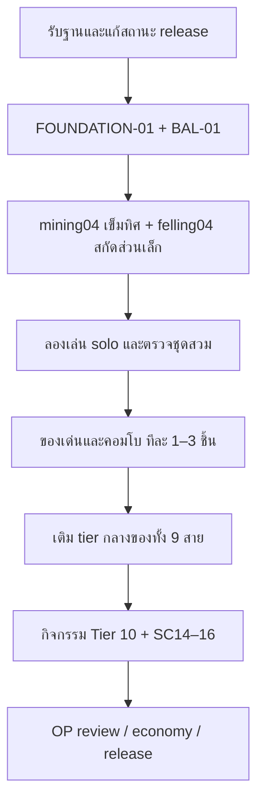

# รับฐาน gameplay ใหม่และปรับแผน Tier 10

วันที่ 2026-10-10 (Asia/Bangkok). ผู้ใช้แจ้งว่า session gameplay จบแล้วและขอให้ตรวจแพทช์ใหม่แล้วกลับมาวางแผนก่อน รอบนี้แก้เฉพาะเอกสาร ไม่ implement รางวัล ไม่ deploy และไม่รัน SQL กับ production

## ฐานที่ใช้และสถานะจริง

HEAD ตอนรับฐาน: `4c514881` (`Shape natural mountain stream banks and continuous wooded foothills`). มีงานค้างใน Town.tsx, ground/lamps และ tests ซึ่งเป็นของ session อื่น; เก็บรายการและ hashes ใน [baseline-review-validation.json](baseline-review-validation.json) ห้ามทับงานเหล่านั้น

เอกสารส่งต่อหลักคือ [adventure-expansion-handoff.md](../../../.claude/skills/fc-cash-town/references/adventure-expansion-handoff.md) ส่วน adventure-expansion.md และ combo-implementation.md เดิมมีข้อความสถานะก่อน release ให้ใช้หลักฐาน release ที่ใหม่กว่าตามตารางนี้

| ชุด | ผลที่รับเข้าฐาน | หลักฐานและขอบเขต |
|---|---|---|
| v180–182, v184–188, v196–197 | gameplay ทั้ง 6 phase ครบ 9 สาย; 225 usable core items | Handoff ระบุ tests/build ผ่าน, site commit `4a529987` deployed และ owner แจ้งติดตั้งแล้ว; authenticated gameplay ทุกสายยังไม่ได้ยืนยันครบ |
| v183 | ถอด/ใส่ hook แยกจากการถือ rod | Handoff รับสถานะติดตั้งเดิม ไม่เสนอให้รันใหม่ |
| v194 | SC01/SC02/SC03/SC11/SC13 พร้อม VFX และสมุดคอมโบ | อยู่ใน 12 ไฟล์ที่ owner แจ้งติดตั้งหลัง deploy; การค้นพบและผลจริงทั้ง 5 ชุดยังต้องทำ live smoke |
| v195 | cache world reads ของแมลง/ป่า/ถ้ำ แยกจากสิทธิ์และข้อมูลผู้เล่น | `.codex/ram-audit/fix-verification.json` ระบุ production_sql_applied=true; SQL เก็บใน applied-v195.sql ไม่ใช่งานค้างให้สร้างใหม่ |
| v198 | เพิ่มปลา 51 ชนิด อาหาร 18 เมนู และ scroll 18 ใบ; ปลาเฉพาะแต่ละ habitat รวม 20 ชนิด | Handoff ระบุ deployed/owner-confirmed installed; 294 usable additions เมื่อรวม core 225 กับปลา/อาหาร 69, scroll ไม่นับซ้ำ |
| v199 | วางของบนภูเขาและถ้ำชั้น 1–30 | Source พร้อม; ยังไม่พบหลักฐานติดตั้งเฉพาะ v199 ในเอกสารที่ตรวจ ไม่อนุมานจากการมีไฟล์ |
| v200 | ลดงาน warm bug reads และคำนวณ crystal ของวันร่วมกัน; cache ยังจำกัด 3 แถว | พบ applied-v200.sql, live-definition replay 141 checks และ v200-live-probe.json 19 checks ผ่านพร้อม member reads; เป็นหลักฐานหลังแพทช์จาก session เดิม ไม่ใช่การ query live รอบนี้. v200-validation.json ที่เขียนก่อนหน้ายังระบุ applied=false จึงไม่ใช้ไฟล์นั้นเป็นสถานะล่าสุด |
| v201 | flame ที่รับ/ส่งใหม่มีอายุ 5 วินาที | Source SQL และ frontend LAMPS.life=5 ตรงกัน; ยังไม่พบผลติดตั้ง catalog/การ deploy frontend รุ่นนี้ในหลักฐานที่ตรวจ |

ลำดับ gameplay ที่ owner แจ้งติดตั้ง: `v180 → v181 → v182 → v184 → v185 → v186 → v187 → v188 → v194 → v196 → v197 → v198` หลังฐานเดิม v179/v183/v195. ไม่ย้อนรันลำดับนี้เพื่อเริ่มงาน Tier 10 และไม่เรียก generator v194 เพื่อแทน function ที่ติดตั้งแล้วโดยไม่เทียบ definition

## หลักฐานตรวจรอบนี้

- อ่าน source และ handoff ของทั้ง 9 สาย รวม patch performance, map/water, ground และ lamp relay
- เทียบ hashes เดิม 15 ไฟล์: 12 ตรง; TownFieldwork.tsx, TownStream.tsx และ icon-atlas.json เปลี่ยนหลัง snapshot เดิม มี UI review/ปลาใหม่เป็นบริบทของการเปลี่ยน ไม่ถือว่า hashes เก่ารับรอง UI ปัจจุบัน
- รัน `npx.cmd vitest run lib/town/adventure-expansion.test.ts lib/town/regional-fish.test.ts lib/town/mountain-water.test.ts lib/town/ground.test.ts lib/town/lamps.test.ts lib/town/private/combos.test.ts lib/town/combo-keeper.test.ts --maxWorkers=2 --testTimeout=30000`: 7 files / 71 tests ผ่าน
- ตั้ง FC_REPO เป็น repo นี้แล้วรัน `E:/NinenineProject/fcnext-codex-bench/release198.test.mjs`: 51 checks ผ่าน รวม replay v195 → expansion/v194/v198 และ feature markers ก่อน/หลัง
- ไม่รัน full suite/build ซ้ำในรอบเอกสาร และไม่อ้างว่าตรวจ live gameplay ครบแล้ว. ผล 2,017 tests/build ใน handoff เป็นหลักฐานของ session เดิม

## เปิด gate ได้แค่ไหน

รับ B-COMMON, B-FISH, B-WOOD, B-MINE, B-GARDEN, B-INSECTS, B-FOREST, B-WATER, B-KITCHEN และ B-HELP เป็น **ฐาน source ที่พร้อมต่อยอด** จาก handoff/tests. คำว่า gate พร้อมไม่ได้แปลว่า contract ของรางวัลทุกชิ้นมีแล้วหรือ live verified ทุกสาย

| สาย | ฐานที่มีจริง | สิ่งที่ยังต้องสร้างให้รางวัล |
|---|---|---|
| ครัว | preparation UUID, 3 คำตอบ, correction ใช้ strongest; cooking/servings/meal quota เดิม | checkpoint คุมไฟแยกขั้น, picnic servings และ provenance ผู้ปรุง/ผู้กิน. SC04/SC08 ยังไม่พร้อมจากแค่มี v197 |
| น้ำ | 8 banks, shared channels, volume/property, 15 นาที resource/route cooldown | ภาชนะปลายทางของ well07, routing ถึง root ของ well08, สิทธิ์แปลงและจำนวน benefit events ของ well10 |
| ผู้ช่วย | ค่าย 5 sites, 30/45 นาที, shared charges และ 3 benefits/คน/วัน | reward flag ต้องต่างจาก camp buff; failed-root receipt, checkpoint whitelist และ consent สำหรับ revive ยังไม่มี |
| ตกปลา | habitat/current, rods/lines/hooks, 20 exclusive fish ต่อ regional habitat และอาหารใช้ปลา | weighted known pool, reel charge, boat boarding/consent/return และ legendary trail. เก็บ tier4 legends ตาม catalog จริง ไม่ถือว่าปลาใหม่ทั้งหมดเป็น legend |
| ป่า | whole/leaf/root, traceLens/traces, shared shares และ rest หลังขุด root | private trail/checkpoint, honey/wax recipes, cap ส่วนที่สองร่วมกับ resource recovery |
| แมลง | routes/lures, manual catches, garden releases, pollination/guard | personal timed habitat/swarm budget และ suppression ของ cloak follower; insects09 ต้องให้ทางเลือกใหม่ที่ต่างจาก pollination เดิม |
| สวน | footprint/root/satellite, deterministic crosses, seedTray/graftKnife/gardenTwine | giant-root yield table, เลือกคู่ที่รู้แล้ว, pollen sample เก็บ/หมดอายุ/ใช้ครั้งเดียว |
| ตัดไม้ | grain/notches/fall/part, barkKnife/sapTap, forged axe และ echo | extraction receipt หลังตัด, cap รวม 2 ส่วน, domino target set และ safe bridge exit |
| เหมือง | hidden rock fate, ore/crystal choices, echo/cavity/preserve tools, rest-floor lift | mineral knowledge สำหรับ scan, repair scraps provenance, visited-floor anchors และ instance budget |

## ข้อแก้แบบและบาลานซ์ก่อน implement

1. **คงจุดเด่นเดิม**: กวางเดินเร็ว 2× และของเดิมที่ผู้เล่นชอบยังเป็นฐาน ไม่เนิร์ฟเพื่อให้ทุกสายเท่ากัน. คะแนน OP เดิมเป็น snapshot ก่อนเครื่องมือใหม่ ต้องประเมินผลเพิ่มเหนือของที่มีจริงอีกครั้ง
2. **แก้ถุงก่อนเพิ่มผลผลิต**: thingBundle ปัจจุบันรับเพียง log/timber และ thingSack ยังใช้ whitelist แร่เดิม. BAL-01 จะเพิ่มเฉพาะวัสดุไม้/ธรณีวิทยาที่เหมาะสม รักษา 3/5 slots และไม่รับ tools, containers หรือ forged stacks; ทดสอบ stow/craft/sell/storage จริง
3. **คำอธิบาย rod ต้องอิงจำนวนสายจริง**: thingRod ยังบอก 2 สาย/2 เหยื่อ แต่คันขั้นสูงใช้ 2→3 สาย. แก้ข้อความ Thai/English และต้นทุนต่อ line ตาม source/RPC ไม่เปลี่ยน mechanic ในงานข้อความ
4. **mining04 ต้องไม่ซ้ำ peek และไม่เผยแผนที่ลับ**: เลือกแร่ที่เคยได้จริง; server หาเป้าหมายที่ยังอยู่บนชั้นปัจจุบันแล้วส่งแค่ทิศ 8 ทิศกับช่วงระยะ near/mid/far. ไม่ส่ง coordinates, hidden fate, seed, crystal ของวัน หรือ way-down. 5 successful scans/วัน; แร่ไม่มีบนชั้น/ไม่มีเป้าหมายไม่หักใช้. ความรู้แร่และ replay receipt เป็น contract ที่ต้องปิดก่อน coding
5. **felling04 เพิ่มทางเล่นหลังโค่น**: ไม่เพิ่ม output ให้แค่ถือมีด. จบ action ตัดจริงแล้วเลือกหนึ่งส่วนเล็ก (bark/sap/seed ที่ต้นนั้นมี) เล่น extraction เพิ่มและจ่ายแรงเดิม. 5 ต้น/วัน และรวม SC10/felling08 ไม่เกิน 2 parts ต่อต้น. Echo/forge ไม่สร้าง extraction receipt ซ้ำ
6. **ชะลอ buff ที่ยังไม่มีเหตุผล**: waterCart solo 0.75× และ Phoenix refund 3→5 เป็นเพียงสมมติฐานทดลอง ไม่ใส่พร้อม reward rollout. preparation มี tastingSpoon/seasoning correction แล้ว; thingSpoon ต้องตรวจว่าช่วย discovery ต่างกันก่อนแก้
7. **คอมโบกับ effect เดิมใช้ strongest**: SC06 เทียบกับ pestWhistle guard, SC09 เทียบ traceLens/traces และ SC18 เทียบ current/surge protection. ถ้า effect ถูกครอบแล้ว ไม่หัก combo quota/ไม่แสดง discovery ของผลที่ไม่ได้เกิด
8. **Tier 10 เป็นกิจกรรมที่จบได้และพักต่อได้**: ยังเก็บแนวคิดเดิมทั้ง 9 finale แต่ห้ามสร้าง shared instance/checkpoint engine ใหญ่ก่อน prototype แรกพิสูจน์ว่าต้องใช้. ทุก run มีหนึ่ง reward budget แม้กลับเข้าหรือเลือกหลายกิ่ง

ตัวเลขและ OP targets ใน rewards.md ยังเป็น prototype ไม่ใช่คะแนนหลัง implement. จอง runtime IDs ทีละชุดก่อนแก้ catalog ไม่เติม declaration ทั้ง 42 ชิ้นล่วงหน้า

## แผนลงมือหลังรอบวางแผน

| รอบ | งานและจำนวน | เงื่อนไขจบที่ตรวจได้ |
|---|---|---|
| 0 — รอบนี้ | SETUP-01 รับฐาน/สถานะ/แผน; ไม่แก้ gameplay | แผนกลางและ migration registry ตรงหลักฐาน, เก็บ snapshot และจุดที่ยังต้องตรวจ live |
| 1 — ชุดแรก | FOUNDATION-01, BAL-01, mining04 และ felling04 (2 รางวัล) | claim ครั้งเดียว, server capability ปิดเมื่อไม่มี patch, use paths ครบ Trial/UI/RPC, quota/receipt/ownership, กระเป๋าเต็ม/expiry/retry/reload, เทียบผลกับ tools/buffs แล้ว playtest |
| 2 — จุดเด่นก่อน | เลือกจาก felling05, mining07, farming07, insects08, helpers08; ทำทีละ 1–3 ชิ้น | ปิด contract เฉพาะชิ้นก่อนรับ; เพิ่ม SC05/SC06/SC09/SC12/SC17/SC18 ทีละชุดตาม action ที่พร้อม ไม่บังคับรอเติมครบ 42 |
| 3 — เติม tier กลาง | FILL ของทุกสาย, forest07, kitchen07, well08 และ fishing08 เมื่อ contracts พร้อม | ทุกสายมี power spike คนละด้าน; เกม manual และ solo progression ยังเดินต่อได้; ไม่เพิ่ม daily chores บังคับ |
| 4 — finale | 9 รางวัลระดับ 10; SC14–16 หลังชิ้นฐานพร้อม | resume/consent/exit, once-only budget, quota หลัง 05:00 Bangkok, UI มือถือ; OP review จากชุดสวมที่ใช้ได้จริง |

ชื่อรอบเป็นลำดับพัฒนา ไม่ใช่วันส่งมอบ. Release เป็นชุดย่อยได้; งานคอมโบ SC04/SC07/SC08/SC10 ที่มี checkpoint/moisture/meal provenance/extraction ให้รอ contract ของตัวเอง แม้ gate gameplay จะพร้อมแล้ว

SC14 ทำได้ทันทีเมื่อ felling05 โดมิโนพร้อม ไม่ต้องรอผู้เล่นถึงระดับ 10; SC15/SC16 ตาม mining09/fishing09. กลุ่ม COMBO-TIER10 ในกระดานหมายถึงคอมโบที่พึ่งรางวัลในแผนนี้ ไม่ใช่เงื่อนไขว่าคอมโบทุกชุดปลดล็อกที่ rank 10

## Foundation และข้อจำกัด performance

- รางวัลใหม่ใช้ capability/gives จาก server catalog จริง; site ใหม่กับ DB เก่าต้องไม่ประกาศให้รับของที่ยังใช้ไม่ได้. การ claim ไม่ซ้ำแม้สองแท็บ และ quotas ใช้ reset 05:00 Bangkok
- ใช้ UUID/run identity/receipt ที่เหมาะกับ action. Validation, จ่ายต้นทุน, usage และ output อยู่ transaction เดียว; replay ไม่จ่ายซ้ำ, full bag ไม่กิน input/สิทธิ์, หมดอายุหรือสลับ loadout ไม่รักษาโบนัสย้อนหลัง
- ไม่เพิ่มการ scan ทุก frame/ทุก poll. เข็มทิศเป็น user-triggered RPC สูงสุดตาม quota; animation เป็น local UI. world data cache ใช้เฉพาะข้อมูลร่วม, knowledge/loadout/targets ของผู้เล่นคงอยู่ใน private/member path
- รักษา invalidation กับ turn/comeback/light/recovery deadlines ของ v195/v200 และ limit cache 3 rows. Function patch ต้องต่อจาก definition ล่าสุดที่ตรวจแล้ว ไม่คัดลอกจาก dump ก่อน v200 หรือถอด guard
- ประเมิน resource/tempo/reliability/access แยกกันด้วย game-op-rating: การชี้ทิศไม่ใช่ guarantee แร่ และเดินเร็วไม่เท่ารายได้เพิ่มเท่าตัว. ไม่ใส่ราคา/ผลผลิตใหม่ก่อนตรวจ input/output และตลาดปัจจุบัน
- ใช้ TownNotebook และ atlas ปัจจุบัน. ภาพใหม่ทำหลัง runtime IDs/ขอบเขตชิ้นนิ่ง; 3 VFX ของคอมโบเดิมใช้ต่อได้. สมุดแสดงเฉพาะ recipes/combos ที่ผู้เล่นพบแล้ว; secret combo registry และกฎของชุดที่ยังไม่พบไม่เข้าฝั่ง browser/API หรือ public patch notes
- Migration ถัดไปยังไม่จอง. มี v201 แล้วใน working tree; ตรวจเลขว่างจริงเมื่อรับ implementation และแยก dependency reward จาก patch ground/lamp ที่อาจยังไม่ได้ติดตั้ง

## สิ่งที่ยังไม่ยืนยันและส่งต่อ

Live smoke ของ claim/equip/discovery และผลคอมโบทั้ง 5 ชุดยังต้องตรวจด้วยบัญชีสมาชิก; probe bugs/cave ของ v200 ไม่ทดแทน gameplay checks เหล่านี้. v199/v201 รอผลติดตั้งเฉพาะ feature markers จาก workflow เดิม ไม่ขวางการทำรางวัลที่ไม่พึ่ง ground/flame

ผู้รวมแผนและการรับฐาน: `tier10 baseline review 2026-10-10` (session นี้). ยังไม่ claim runtime task รอบ 1 และไม่ถือว่าผู้ใช้ขอ deploy ในรอบวางแผนนี้. แชทถัดไปอ่านเอกสารนี้ร่วมกับ work-board.md ก่อนรับ FOUNDATION-01/BAL-01 แล้วปิด mining04/felling04 contracts
